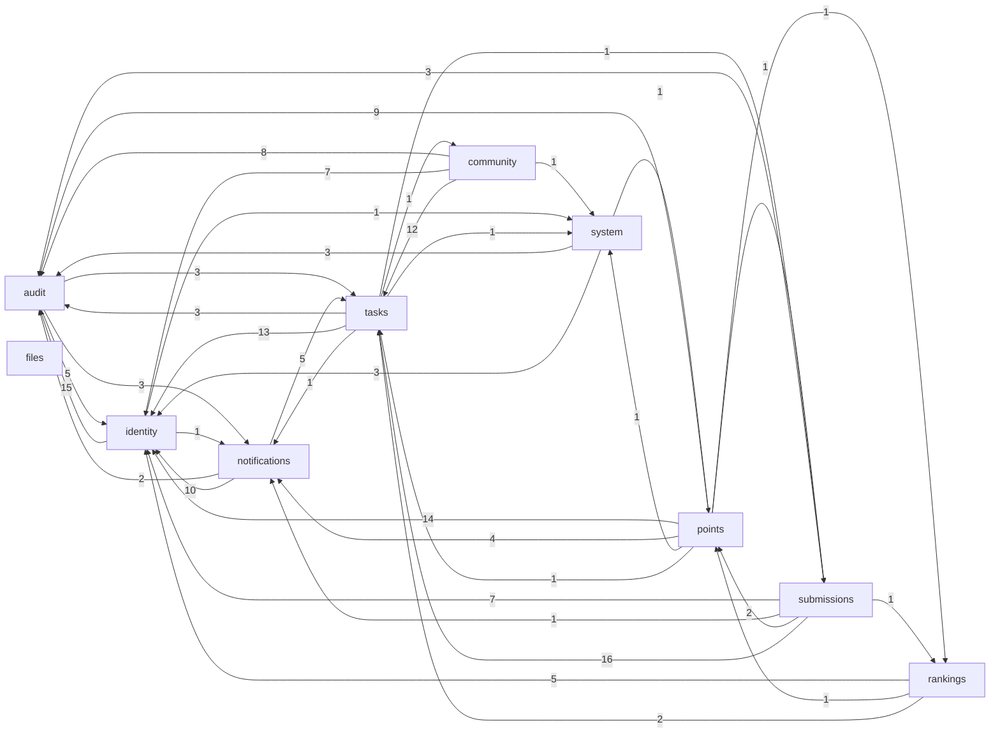
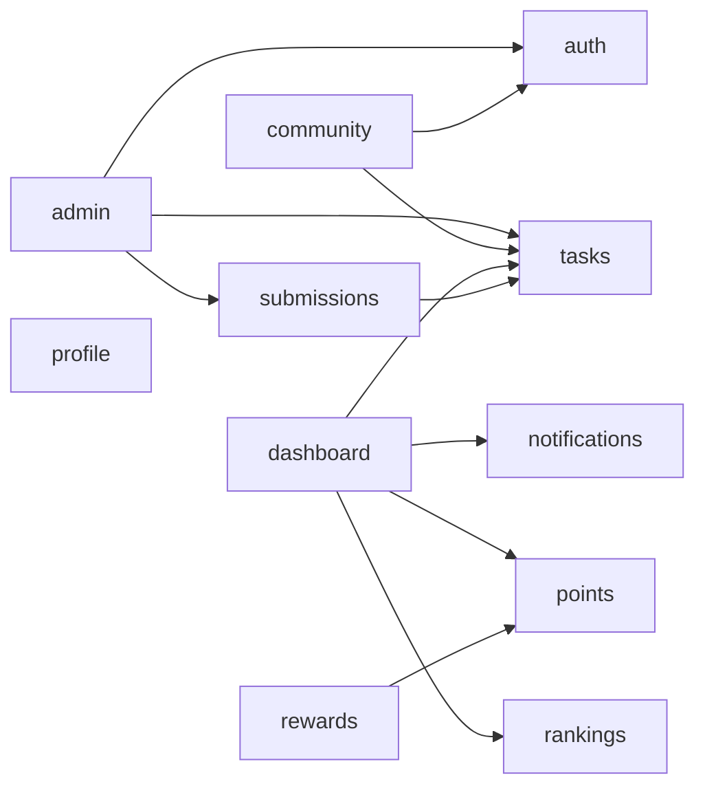

# CampusQuest As-Built Architecture Map

<!-- AUTO-GENERATED by scripts/generate_as_built.py (make arch-map).
     Do not edit by hand: regenerate and commit instead. The gate
     (`make arch-lint`) forgives documented drift; this map reports
     the tree as it is. Generated from HEAD 08fc979. -->

Regenerate: `make arch-map`. The contract gate is `make arch-lint`
(config: `backend/pyproject.toml [tool.importlinter]`,
`frontend/.dependency-cruiser.cjs`).

## Backend: cross-module dependency graph

Nodes are `app/modules/*` packages plus `workers`; edges are
import counts (aggregated over files, both directions collapsed
into one directed edge per pair with the true direction shown).

Module shape (router / service / total files):

| module | routers | services | files |
|---|---|---|---|
| audit | 1 | 2 | 6 |
| community | 1 | 6 | 14 |
| files | 0 | 1 | 1 |
| identity | 5 | 7 | 29 |
| notifications | 1 | 3 | 11 |
| points | 2 | 3 | 7 |
| rankings | 1 | 3 | 8 |
| submissions | 1 | 5 | 12 |
| system | 1 | 1 | 3 |
| tasks | 1 | 5 | 16 |

## Backend: boundary debt (truth side, no waivers)

- workers import: modules.files, modules.identity, modules.notifications, modules.rankings, modules.submissions, modules.tasks (jobs call module services — the documented orchestration-shell pattern)
- **identity ORM models imported outside identity (rule: directory port only — interfaces.md)** — 5 files (2026-10-16), waived in the gate
  - `modules/notifications/deadline_scheduler.py`
  - `modules/notifications/delivery_service.py`
  - `modules/notifications/event_handlers.py`
  - `modules/notifications/port.py`
  - `modules/notifications/service.py`
- **modules import the worker runtime (dispatch seams)** — 2 routers (2026-10-16), waived in the gate
  - `modules.points via modules/points/router`
  - `modules.submissions via modules/submissions/router`
- **cross-module ORM model imports (quality-gates §6: reach through contracts/ports, not ORM internals)** — not gated — visibility only
  - `modules.audit imports modules.notifications.models`
  - `modules.audit imports modules.tasks.models`
  - `modules.community imports modules.tasks.models`
  - `modules.notifications imports modules.identity.models`
  - `modules.notifications imports modules.tasks.models`
  - `modules.points imports modules.notifications.models`
  - `modules.points imports modules.tasks.models`
  - `modules.rankings imports modules.points.models`
  - `modules.rankings imports modules.tasks.models`
  - `modules.submissions imports modules.tasks.models`

## Frontend: feature dependency graph

Composition roots (allowed to import freely): `src/app` routes,
`src/components/shell` app chrome. Bottom layers: `src/lib`,
`src/components/ui`.

Boundary crossings out of bottom layers (should stay empty):

- none
